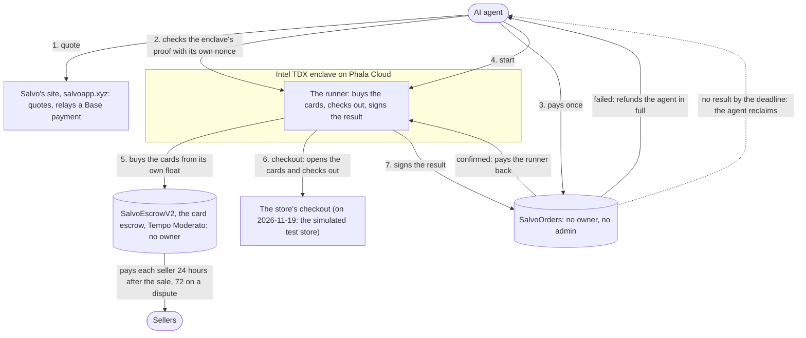

# Salvo

The discount layer for agent checkout.

An AI agent sends Salvo its cart and pays once into an order escrow. Salvo
buys discounted gift cards for that cart and runs the checkout. The money
moves only on a result the runner signs: a confirmed order pays the runner
back, and a failed one refunds the agent in full.

> **Testnet only, and unfinished.** Everything here runs on test networks with
> test money. The only store that checks out is a simulated test store that
> charges nobody. This repo is a public excerpt of a private codebase: the
> order escrow and the card escrows, the order terms and pins, the outside
> check of the enclave, the agent skill's instructions, the routing engine,
> the till and the seller flow, with the tests that run without a database.

## From the register to agents

Salvo started as a phone app for paying at the register: the shopper types the
total, Salvo picks discounted gift cards, and the cashier scans a barcode. It
stalled on the register itself. A barcode sends nothing back, so Salvo can't
see whether a scan worked, and a till takes only one or two cards per
purchase. Agents have the opposite problem: they can pay, but they break at
checkout. Online checkout shows what each card applied, and takes several
cards per order. So Salvo takes the agent's cart and its payment, and does
the checkout part itself.

## What an agent does

1. **Quote.** It sends its cart (store, cart total, its own address) and gets
   back the order's terms, their hash and exactly how to pay. It checks all of
   them before it pays.
2. **Check the runner.** It sends the enclave a fresh random nonce of its own
   and checks the Intel TDX proof that comes back.
3. **Pay once** into `SalvoOrders`. On Tempo Moderato: `approve`, then `open`,
   two plain transactions. On Base Sepolia: one signed USDC authorization,
   which Salvo relays and pays the gas for. Either way the money goes from the
   agent's wallet straight to the contract.
4. **Start** the order and follow it to its settlement, then check the
   settlement on chain: the order is settled, and the result and refund are
   the ones Salvo reported.
5. **Reclaim** if nothing settled by the deadline (90 minutes). The agent
   calls `reclaim(orderId)` on the contract itself. It needs nothing from
   Salvo.

There are two kinds of order. `checkout`: the runner opens the cards inside
itself and runs the store's checkout, so the agent never sees a card number.
`cards`: each card comes back sealed to the agent's own key, and the runner
does not open it. The order settles once each card has been bought and sealed
to the agent's key; it does not wait for the agent to use the card.

## Who holds the money

| Who is paying | Where the money waits | Who can move it |
|---|---|---|
| An AI agent ordering through Salvo | `SalvoOrders`, a contract with no owner and no admin | Only the runner's signed result: paid on a confirmed order, refunded in full on a failed one. After the deadline the agent takes it back itself |
| An agent or a shopper's phone buying a card directly | `SalvoEscrowV2`, the card escrow, also with no owner | The contract's own rule: the seller is paid 24 hours after the sale, or 72 if the buyer disputes |
| A person buying movie tickets | The card processor, on a test key | The card processor |

Salvo's own wallet holds no buyer's money on any of these. Two older paths
did send an agent's stablecoins to Salvo's wallet, and both are switched off:
the first gift card buy path (`/api/agent/buy` answers `410 use_escrow`) and
paying for movie tickets in stablecoins (`410 stablecoin_tickets_off`, since
2026-11-19). Their code is not in this repo.

## How it works



The runner buys cards on `SalvoEscrowV2`, the same card escrow the in-store
till uses, from its own float. That escrow pays each seller 24 hours after the
sale, or 72 hours if the buyer disputes. It has no owner, admin key, fee,
pause or upgrade path. Neither has `SalvoOrders`. Its `token`, `runner` and
`payout` are fixed in its code, so a pin on the deployed code hash pins all
three. "Pays the runner back" means: on a confirmed order the contract sends
the order's money, less any refund to the agent, to that fixed payout
address. For the enclave's contracts that is the enclave's own key on Tempo
Moderato and Salvo's existing Base wallet on Base Sepolia (both listed
below).

## What works on testnet, and how to check it

Two networks, test money only.

| Network | Chain id | Token | How the agent pays |
|---|---|---|---|
| Tempo Moderato | 42431 | pathUSD | `approve`, then `open` |
| Base Sepolia | 84532 | USDC | one EIP-3009 signature; Salvo relays it |

**The contracts.**

| Contract | Tempo Moderato | Base Sepolia |
|---|---|---|
| `SalvoOrders`, the enclave's | `0x6fda8e153681581b278ac680d2d60144fa121a3f` | `0x5a02a2e56c82fb7dcccdeea42a6d35a83c474a58` |
| `SalvoOrders`, Salvo's server's | `0x2c204a3f3bb26ea7214fd2ee0d91e2b82fec90ff` | `0x274535ee44ea2132a4fd41334756c5c6f0253ef4` |
| `SalvoEscrowV2`, the card escrow | `0xa30d1631bf644fa608dacc02b6d2aebbc1cd200b` | not deployed |

The enclave's runner keys: `0xf750a9a069aaa9c6c885ea51440f0a88dba0c35d` on
Tempo Moderato (also its payout) and `0x0e2f50233772167f53221c86d215d62d53728b49`
on Base Sepolia (payout `0x30201522adf8ffb29b3fea0f7927a628a48d4329`, Salvo's
existing Base wallet). Every value, with each contract's code hash, is in
`src/lib/agent/orders/enclave-pins.ts` and `src/lib/agent/orders/pins.ts`.

**The runner is an Intel TDX enclave** on Phala Cloud (dstack), on real
hardware since 2026-11-19, with its own two order contracts above. Its keys
are made inside it, its contracts take a result signed only by those keys,
and a checkout's cards open only inside it.

- App id: `0x57e1889572bf23e7198cd6814b62154981ef6036`
- Compose hash: `0x77576f59634f0fa27d9c391a46dce6b648934d3691db0424a34f87dd65f03e34`
  (measured 2026-11-21; it changes with every new image, and the agent's
  client pins the current one)
- Gateway: `https://57e1889572bf23e7198cd6814b62154981ef6036-8080.dstack-pha1-prod5.phala.network`
- What its quote measured on 2026-11-19 (OS values, key provider, TCB
  `UpToDate`): `deploy/enclave-inspect.json`

What the enclave does not prove yet:

- **Phala Cloud KMS.** The owner or Phala could run other code under the same
  app id and keys. That code could sign any result. Every enclave answer says
  so.
- **The OS image.** Its values are pinned from the enclave's own first quote,
  not from an independent verifier. Every check says
  `OS IMAGE NOT INDEPENDENTLY CHECKED`.

The runner's code and its image are private until launch, so the public cannot yet
match the compose hash to source. What you can check is that the same measured
code, with the keys and contracts pinned here, answers your nonce.

The enclave machine has an on and off switch, to save money during the build.
While it is off, orders at the test store run on Salvo's own server, on the
server's own contracts above, and every answer says `simulated: true`.

**Live orders through the enclave, 2026-11-19.** Ten test orders ran through
it on both networks. Each outcome is the agent's own check of the chain.

| Network | Order | Result | Settle or reclaim transaction |
|---|---|---|---|
| Tempo Moderato | checkout, $1.00 cart | fulfilled, paid $0.90 | [0xc83f…48c7](https://explore.testnet.tempo.xyz/tx/0xc83f8c26d899364ae534d9eb7c319caa5eb422d53ad7950c96e83e8f382448c7) |
| Tempo Moderato | checkout, the test store declines | refunded $2.25 in full | [0x9286…ed62](https://explore.testnet.tempo.xyz/tx/0x9286f7a7883d9d16ec1d8a043a5147f9c98ddf788ab305c29fa60b2f9025ed62) |
| Tempo Moderato | cards, never started | the agent reclaimed $0.90 itself | [0x901f…a9e9](https://explore.testnet.tempo.xyz/tx/0x901f8f122b4e0b06a8d5ac58292a2a46c3aeee3401cd97c4b1e123260fa5a9e9) |
| Base Sepolia | checkout, $1.00 cart | fulfilled, paid $0.90 | [0x4dad…7592](https://sepolia.basescan.org/tx/0x4dad7ee4447a01ed982e0b8a077a8ca6f2f3b8e713268db7789c6ae9eefc7592) |
| Base Sepolia | cards, $1.00 | fulfilled, 1 card opened with the agent's own key | [0x483a…c39d](https://sepolia.basescan.org/tx/0x483a13a3f25181b041231e6550692e91c930f5275f4eb43c765aeb782d16c39d) |
| Base Sepolia | checkout, the test store declines | refunded $2.25 in full | [0x3691…7942](https://sepolia.basescan.org/tx/0x36912c76734c5e0cdd6ce417d423758c176cfd542657da603bec22f8d4267942) |
| Base Sepolia | cards, never started | the agent reclaimed $0.90 itself | [0xbe29…1637](https://sepolia.basescan.org/tx/0xbe29afcce81819530d4089e71262bd3efdda9a1b51ebfe22db8f0ba40beb1637) |

All ten, and every earlier run, are in [docs/agent-runs.md](docs/agent-runs.md).

## Check the enclave yourself

With a fresh nonce of your own, from outside (the machine must be switched
on). If it does not answer, the machine is off, and
`deploy/enclave-inspect.json` holds what its quote measured on 2026-11-19.

```bash
pnpm install
pnpm enclave:verify https://57e1889572bf23e7198cd6814b62154981ef6036-8080.dstack-pha1-prod5.phala.network
```

It asks the enclave for its identity with your nonce and checks it with
`src/lib/agent/enclave/verify.ts`: Intel's signature chain on the quote
(`@phala/dcap-qvl`), not a debug machine, TCB status `UpToDate`, your nonce
and the identity's hash in the report data, the event log replayed to the
quote, then the measured app id, compose hash, key provider and OS values
against `src/lib/agent/orders/enclave-client-pin.ts`, and each runner key's
signature over the identity. It must print `proof tdx`, the app id and the
compose hash above.

## The skill

Salvo's agent skill is plain instructions and one bundled script that runs
with plain `node` and no install step. It gets the quote and checks it before
the agent pays, including the enclave's proof, and checks the settlement on
chain after. A fresh agent that had read only the skill's instructions placed
an order with it on 2026-11-19.

The flow is `info`, `quote`, pay with the agent's wallet tool, then `start`.
`order --key-file` does all of it in one command, for an agent with no wallet
tool, paying from a test key in a file.

The instructions are in `skills/salvo/SKILL.md`. The bundled script and its
source are built in the private codebase and are not in this repo yet.

## The direct path

An agent's wallet can also pay `SalvoEscrowV2` itself on Tempo Moderato and
get each card sealed to its own key, with no runner at all
(`src/lib/agent/escrow-agent.ts`). Salvo never sees the card or holds the
money.

## The rebuilt escrow, on testnets since 2026-11-20

The order escrow was rebuilt to one rule: the escrow holds the agent's money
until there is a signed result. Nobody buys a card first. A card opens to the
checkout only because a funded order reserved its listing, sellers are paid
out of the order after the store's hold, and a failed checkout refunds the
agent and leaves the cards for sale. It runs beside the older path described
above, at the simulated test store only, with test money.

| Contract | Network | Address |
|---|---|---|
| Listings | Tempo Moderato | `0xbd622504940adcdaa9b19ff26f641a2c35f1f511` |
| Order escrow | Tempo Moderato | `0x4a6a5a64f21aadaece39a96ada0d70125b52dc20` |
| Signer group | Tempo Moderato | `0x8d1c791c2f49c90a7425c6c07cca812dfec394fd` |
| Order escrow | Base Sepolia | `0xe6bf38bd68f4bce480c5b8e48a3560ee01f2d3f6` |

Run live on 2026-11-20, each read back from the chain by the agent's own
client:

- A good order paid on Tempo, and one paid on Base.
- The seller paid from the escrow after the two-hour hold.
- A declined checkout: the agent refunded in full, and the same card used by
  the next order.
- A card the store found empty, and one it found short: the order refunded,
  that seller not paid.
- An order opened and never started: the agent took its money back itself
  after the deadline, with the enclave switched off.

What that does not show: a real store, real money, or more than a handful of
orders. Listed cards are sealed to one key inside a TEE for now (see the
roadmap item below), and on testnet one copy of each sealed card is kept, not
the two the design calls for. The contracts and the checkout code for this
path are not in this excerpt yet.

## Not working yet

- **No real store checks out.** The checkout inside the runner is the
  simulated test store (`salvotest`), which charges nobody. No real gift card
  has been spent this way and no real money has moved.
- **Checkout at a real store is not built.** Nothing applies gift cards at a
  real store's online checkout yet.
- **A bad card has no refund yet on a first sale.** The card escrow has no
  owner, so nobody can rule on a claim that a card was empty. A dispute only
  holds the seller's payout 48 hours longer; only the seller can refund. When
  Salvo runs the checkout and a card fails, the agent is refunded in full and
  Salvo carries the loss. When an agent takes whole cards and checks out
  itself, the agent carries it. The planned fix is for the enclave to sign
  what the store said about each card, and for a new version of the card
  escrow to pay or refund on that.
- **Store terms.** Almost every store's terms forbid resold gift cards. That
  is an open business problem.
- **Not built:** stores as data, relisting the cards from a failed checkout,
  on-chain KMS, and any partner checkout.
- **Roadmap: MPC for stored cards.** Today a listed card is sealed to one key
  that lives inside a TEE (Lit, on Intel TDX), and a second TEE runs the
  checkout. A TEE is the right tool for typing a card into a store's checkout,
  where only the cards in flight are exposed. It is not where the key to every
  stored card should stay. The plan is to split that key across independent
  parties (MPC, for example any 3 of 5), so a card opens only when enough of
  them each check the chain and each send one piece to the buyer's one-time
  key, and no single TEE, operator or vendor can open stored cards. The
  listing contract already lets a seller move cards to a new sealer with one
  approval, without listing them again.
- **The first stores are chosen, not captured.** A guided capture tool in the
  private repo has rows for seven stores, by the kind of checkout problem
  each has: Best Buy and Nike (card typed at checkout), Home Depot and Walmart
  (signed in, the card stays a card), Target (the card binds to the account),
  Apple and Starbucks (the card is loaded into a balance). No capture has been
  run.

## What's in this repo

| Path | What it is |
|---|---|
| `contracts/SalvoOrders.sol` | The order escrow: one payment in, out only on the runner's signed result or the buyer's reclaim |
| `contracts/SalvoEscrowV1.sol`, `contracts/SalvoEscrowV2.sol` | The card escrows. V2 sells one card in parts: the buyer pays only for the value used, and the leftover goes back on sale backed by the buyer's deposit |
| `src/lib/agent/orders/` | The order terms and their hash, the pins for both runners' contracts, the enclave's identity pin, and the compiled contract |
| `src/lib/agent/enclave/`, `scripts/enclave-verify.ts` | The outside check of the enclave's proof, and the identity document's shape and hashes |
| `skills/salvo/SKILL.md` | The agent skill's instructions |
| `src/lib/agent/escrow-agent.ts` | The direct path: an agent's wallet buys on the card escrow |
| `src/lib/escrow/` | Around the card escrow: EIP-712 terms and hashes, listings, chain reads that require two independent hosts to agree on the same finalized block, and the keeper's settlement rules |
| `src/lib/vault/` | Card sealing: the number is sealed at listing and opened only for the buyer who paid |
| `src/lib/route/`, `src/lib/demand/`, `src/lib/supply/matching.ts` | The routing engine: drain cards in order so only the last is part used, under a per-card leftover cap |
| `src/lib/till/`, `src/app/pay/`, `src/app/sell/`, `src/app/account/` | The in-store till, the seller's listing screens and the account page (Next.js, React) |
| `deploy/enclave-inspect.json`, `docs/agent-runs.md` | What the enclave's quote measured, and the log of live test runs |
| `tests/` | The tests, including the contracts run on an in-process EVM |

Not in this repo: the runner's code and its enclave image, the agent's order
client, the signing code, the order chain code, the skill's script and its
source, Salvo's own order routes, the app's settings, the database layer,
store integrations, pricing and operations tooling. A few files here import
modules that stay private, so the app doesn't build or run from here. The
tests and the enclave check do.

## Run the tests

Node 20.19 or later and pnpm 11 (`corepack enable`), then:

```bash
pnpm install && pnpm test
```

That runs 21 test files (419 tests) in under a minute, with no database,
network or keys. It covers the order escrow and the card escrows (compiled
with the pinned `solc` and run on an in-process EVM), card sealing and
hashing, routing, the till and the seller flow.

The other 22 test files are listed in `vitest.config.mts` with the reason each
is skipped. They need the private Postgres database or unpublished modules,
and run in the private codebase. The tests of the runner, the order client,
the order routes, the skill and the enclave's identity are private with the
code they test.

## Stack

TypeScript (strict), Solidity, viem, Next.js 15, Phala dstack (Intel TDX),
`@phala/dcap-qvl`, Lit Protocol, Vitest.

---

Copyright Jordan Yeakley. All rights reserved. Shared for review; no licence
is granted to use, copy or modify this code.
