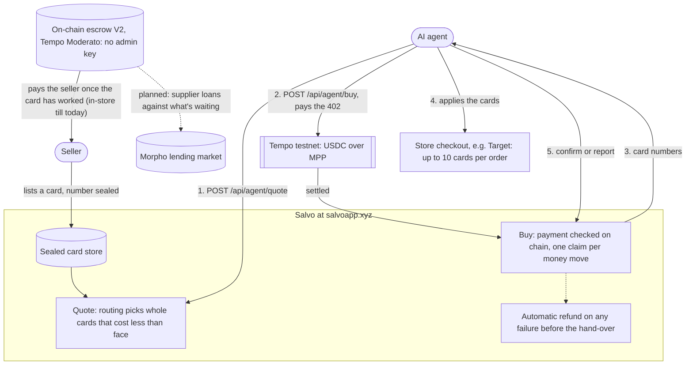

# Salvo

An endpoint AI agents call to pay for purchases with discounted gift cards and
other "friction assets" (value stuck where its owner can't easily use it), over
MPP and x402.

> **Testnet only, and unfinished.** Everything here runs on test networks with
> test money. This repo is a public excerpt of a private codebase: the agent
> endpoint, the escrow contracts, the routing engine, the till and the seller
> flow, with the tests that run without a database.

## From the register to agents

Salvo started as a phone app for paying at the register: the shopper types the
total, Salvo picks discounted gift cards, and the cashier scans a barcode. It
stalled on the register itself. A barcode sends nothing back, so Salvo can't
see whether a scan worked, and a till takes only one or two cards per
purchase. Agents have the opposite problem: they can pay, but they break at
checkout. So Salvo became an endpoint they call: get a quote, pay per purchase
in stablecoins, and receive cards the store's online checkout accepts (Target
takes up to 10 per order, each at an exact amount).

## Status

Testnet: Tempo Moderato (MPP payments, escrow) and Base Sepolia (x402).

**Works on testnet**
- The agent endpoint is live at `salvoapp.xyz/api/agent`: quote, buy over MPP,
  the card hand-over, confirm, report, and recovery of a lost buy response.
- End-to-end test, Nov 15: an agent got a quote from
  `salvoapp.xyz/api/agent/quote` ($18 for a $20 Target gift card) and paid over
  MPP on Tempo testnet with `mppx`.
- Money safety: every payment is used once, and every refund or deposit return
  claims a database row before any money moves. A failure before the hand-over
  refunds automatically; after it, a person decides. The rules went through
  eight review rounds.
- Partial use, opt-in: one part-used card with a refundable deposit for its
  leftover, at stores that don't tie a card to one account.
- Escrow V1 and V2 deployed on Tempo Moderato, with no owner or admin key. The
  card number is sealed at listing and opened only for the buyer who paid.
- An x402 door on Base Sepolia, built and tested. It is switched off on the
  live deployment right now.

**Not working yet**
- **Redemption at checkout.** In the Nov 15 test, Target refused the card at
  checkout ("gift card already added to your account"): Target ties a card to
  the first account that adds it. Checkout redemption is not yet reliable.
- **Card validation before sale.** Cards aren't balance-checked before they
  are sold. Balance reads exist for Best Buy and Nike but aren't wired in.
- **Agent sales and the escrow.** Agent payments settle to Salvo's wallet; they
  don't go through the on-chain escrow yet. The escrow serves the in-store till.

**Morpho:** supplier lending is designed, not built. The vault adapter for idle
escrow money is built and tested but not yet run against a live vault.

## Agent quickstart (testnet)

What the endpoint does, and every call it takes:

```bash
curl https://salvoapp.xyz/api/agent
```

A free quote for a $23.40 Target cart. A quote holds 2 minutes and reserves
nothing:

```bash
curl -X POST https://salvoapp.xyz/api/agent/quote \
  -H 'Content-Type: application/json' \
  -d '{"merchant":"target","cartTotalCents":2340}'
```

When no discounted cards are listed, the answer says so and nothing is
charged: `{"quote":null,"reason":"no discounted online cards at target right now"}`.
Otherwise it looks like this (example, with the Nov 15 numbers, trimmed):

```json
{
  "quote": {
    "merchant": "target",
    "cartTotalCents": 2340,
    "coveredCents": 2000,
    "chargeCents": 1800,
    "savingCents": 200,
    "remainderCents": 340,
    "cards": [{ "valueCents": 2000, "costCents": 1800 }]
  },
  "buy": { "method": "POST", "url": "https://salvoapp.xyz/api/agent/buy" }
}
```

Buy. The endpoint answers `402` with an MPP challenge, and `mppx` pays it in
test USDC on Tempo and returns the card numbers and a purchase token.
`maxPriceCents` is the most you'll pay; a higher price is refused with nothing
charged.

```bash
npx mppx@0.8.17 account create
npx mppx@0.8.17 account fund --network testnet
npx mppx@0.8.17 https://salvoapp.xyz/api/agent/buy --network testnet \
  -J '{"merchant":"target","cartTotalCents":2340,"maxPriceCents":1800}'
```

Then apply each card at the store's checkout and report what it applied with
`POST /api/agent/confirm`, or a problem with `POST /api/agent/report`.
`GET /api/agent` lists the bodies.

## How it works



1. **Quote.** Routing picks whole cards, largest first, that cover as much of
   the cart as they can without going over. A card that doesn't cost less than
   its face value is never offered, and a quote with no saving is refused.
2. **Payment.** The buy call answers `402` with an MPP challenge signed for this
   route only. The agent pays in USDC on Tempo, and Salvo checks the transfer
   on chain, bound to that challenge, before anything is handed over.
3. **Hand-over.** The payment is claimed first, so it can be used once. Then
   one database transaction takes the cards off sale and records the order. Any
   failure before the hand-over puts the cards back and refunds.
4. **Checkout.** The agent applies the cards in the buyer's own store account
   and pays any remainder its usual way.
5. **After.** The agent reports what the store applied. A problem pages a
   person, who checks the cards; cards that were empty or rejected are refunded.

The escrow is the settlement layer for sellers. Payouts wait 24 hours, and 48
more if anyone disputes. It has no owner, admin key, fee, pause or upgrade
path.

## Key product decisions

**Why agents and not shoppers.** At a register, Salvo can't see whether a
scan worked, and a till takes one or two cards. Online checkout shows what each
card applied, and Target takes up to 10 cards at exact amounts. Agents add
three things: they can follow a precise script, they pay per call in final
stablecoins (so Salvo holds no float and takes no credit risk), and their
failures are at checkout, which is the part Salvo works on. The endpoint acts
like a call option for the agent: it is only used when it wins.

**Why escrow through the shipping and return window.** A seller is paid only
once the value is proven: the card worked, and for shipped orders, the return
window closed. Paid earlier, a return or a dead card has nothing behind it.
Today's escrow holds 24 hours, plus 48 on a dispute.

**Why Morpho.** Agents pay in minutes, but suppliers wait: a seller until an
agent buys the card, a cash-advance cardholder until the return window closes.
Morpho lets them borrow against what's waiting. How safe each loan is, out of 5:

| | Waiting for an agent order | During the return window |
|---|---|---|
| **Gift card seller** | Balance merged into Salvo's account: **5**<br>Seller keeps the number: **3** where Salvo can read the balance, **1** where it can't | Card held in Salvo's account: **5**<br>Readable store: **3**, unreadable: **1** |
| **Cash-advance cardholder** | Nothing to lend against: **n/a** | Final sale: **5**, but short (shipping days only)<br>Returnable: **3.5**, with the stake cap |

- **5s are a closed loop.** The collateral can't be spent behind Salvo's back,
  so outside lenders on Morpho fund it. On a default, routing prices the card
  cheapest and the next agent order buys it: routing is the liquidator.
- **The rest is credit run like a Morpho curator vault.** The rules are code:
  loan size by category, a cap per person, how fast limits grow.
- **Returns are why returnable loans score 3.5.** A store refunds the
  cardholder's card wherever the return happens, so a return zeroes the
  collateral and the loan becomes unsecured. The fix is the stake cap: no one
  borrows more against returnable orders than Salvo can collect from them
  (their stake, money parked in the app, payouts whose window has closed). A
  card feed catches a cheat the next day, so their other payouts freeze.

How the model changed with the move to agents:

| | Consumer till app | Agent endpoint |
|---|---|---|
| Main use | Interest on idle escrow money | Cash now for suppliers; agent money waits only minutes |
| Who repays on a default | A liquidator | Routing: the next agent order |
| Drained collateral caught | At the next buyer's scan, after the fact | At checkout, before the agent pays |
| Returns | The open problem | Priced: held payouts, the stake cap, a card feed |

Build order: the closed loops first (merged balances, final-sale advances),
then returnable lending once there's return data.

**Unit economics of the spread.** Gift card exchanges buy cards for cash, then
carry the inventory, the fraud on unverified cards and the dead stock. That
cost is their spread. Salvo buys nothing until a buyer is paying, so it carries
none of it, and the spread can be split: the buyer pays less than face, and the
seller gets more than an exchange would pay. In the Nov 15 test the agent paid
$18 for a $20 card, a 10% saving. Payment is spot stablecoins: no float and no
credit risk, only small network fees. The costs Salvo does carry are failed
checkouts and the refunds that follow, which is why redemption reliability is
first on the roadmap. How Salvo's own take is set is not part of this repo.

**The main risks, and how I'd handle them.**
- **Card validity.** A listed card can be empty, already used, or spent by
  the seller after listing. Today, cards are drained fully so a leaked number
  is worth nothing afterwards, payouts wait out the release window, and any
  failure before the hand-over refunds the agent automatically. Next is a
  balance read before every sale where the store allows one (roadmap item 2).
- **Fraud.** Both sides can cheat. A seller can spend a card after listing it,
  and an agent can spend the cards and then claim they were empty. So nothing
  is refunded automatically after the hand-over: a person checks, and the
  seller's payout waits. A part-used card is backed by a deposit at face
  value, so spending the leftover yourself nets nothing.
- **Merchant acceptance.** Every store's checkout has its own rules. Target
  ties a card to one account, stores limit cards per order, and bot checks
  guard checkout. Salvo never gets around a bot check: a person answers it,
  and the plan is for that answer to double as approval of the purchase.
  Agents buy in the user's own store account, so no single account buys for
  many people. Each store's rules are recorded from its public pages, and a
  store nobody has checked gets the most careful defaults. The cost that scales is one adapter
  per store, which breaks when the site changes.

## Demo

A 3-minute testnet walkthrough video is coming.

## Roadmap

1. **Make redemption at checkout reliable.** Detect a card that's already tied
   to an account before selling it, prefer stores that take a card by number
   for each order, and finish checkout from Salvo's own store account (quote
   live, checkout in progress).
2. **Validate cards before sale.** Read the balance before every sale where
   the store allows it, and keep proof of what checkout applied everywhere else.
3. **Build supplier lending on Morpho,** closed loops first.

## What's in this repo

| Path | What it is |
|---|---|
| `src/lib/agent/`, `src/app/api/agent/` | The agent endpoint: quote, buy over MPP, the on-chain payment check, one claim per money move, refunds, confirm and report, and the sweep that catches anything left unfinished |
| `src/lib/mpp.ts`, `src/lib/crypto-refund.ts` | The MPP payment runtime on Tempo, and the refund transfer |
| `contracts/` | The escrow. V2 sells one card in parts: the buyer pays only for the value used, and the leftover goes back on sale backed by the buyer's deposit |
| `src/lib/escrow/` | Around the escrow: EIP-712 terms and hashes, listings, chain reads that require two independent hosts to agree on the same finalized block, and the keeper's settlement rules |
| `src/lib/vault/` | Card sealing: the number is sealed at listing and opened only for the buyer who paid (Lit, or a local envelope) |
| `src/lib/route/`, `src/lib/demand/`, `src/lib/supply/matching.ts` | The routing engine: drain cards in order so only the last is part used, under a per-card leftover cap |
| `src/lib/till/`, `src/app/pay/`, `src/app/sell/`, `src/app/account/` | The in-store till, the seller's listing screens and the account page (Next.js, React) |
| `tests/` | The tests, including the contracts run on an in-process EVM |

Store integrations and checkout runners, Salvo's own store account, the
Morpho adapter, the database layer, pricing and operations tooling stay in the
private repo, so the app doesn't build or run from here.

## Run the tests

Node 20.19 or later and pnpm 11 (`corepack enable`), then:

```bash
pnpm install && pnpm test
```

That runs 20 test files (373 tests) in under a minute, with no database,
network or keys. It covers the escrow contracts (compiled with the pinned
`solc` and run on an in-process EVM), card sealing and hashing, routing, the
till and the seller flow.

The other 23 test files, the agent endpoint's among them, are listed in
`vitest.config.mts` with the reason each is skipped. They need the private
Postgres database or unpublished modules, and run in the private codebase.
There, the agent, refund and payment tests passed 142 of 142 on Nov 16.

## Stack

TypeScript (strict), Next.js 15, Solidity, viem, mppx (MPP on Tempo), x402
(Base), Lit Protocol, Prisma and Postgres, Vitest.

---

Copyright Jordan Yeakley. All rights reserved. Shared for review; no licence
is granted to use, copy or modify this code.
